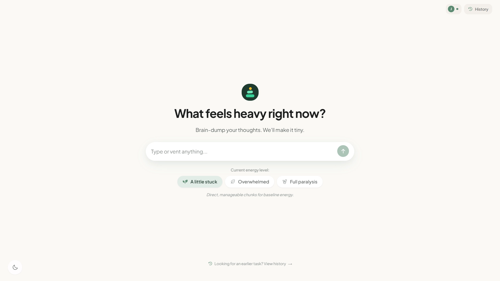
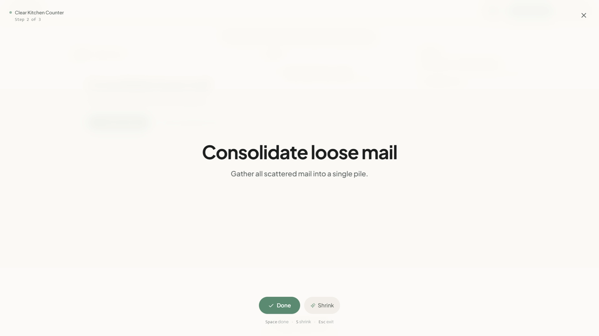
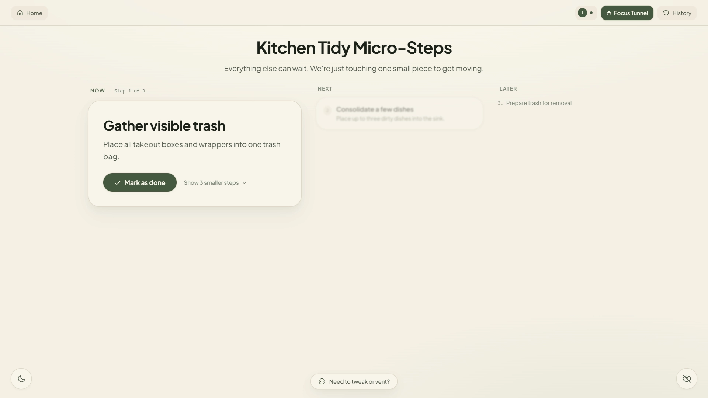
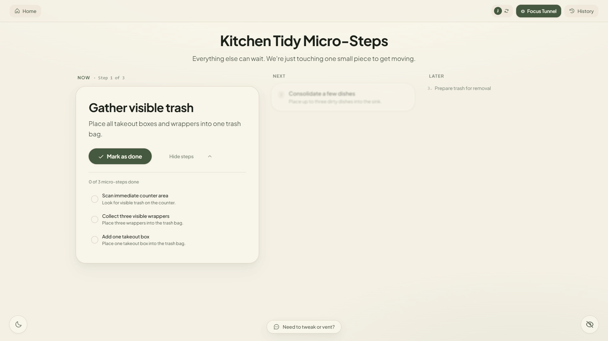
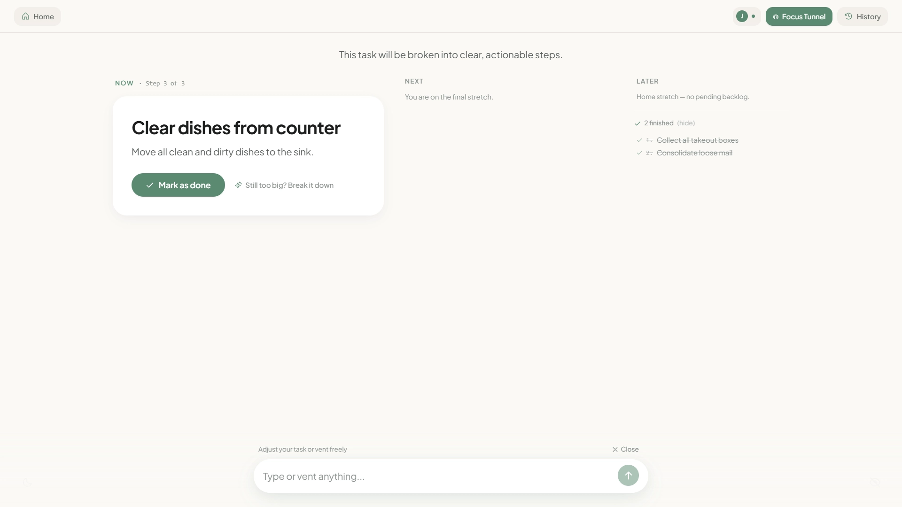
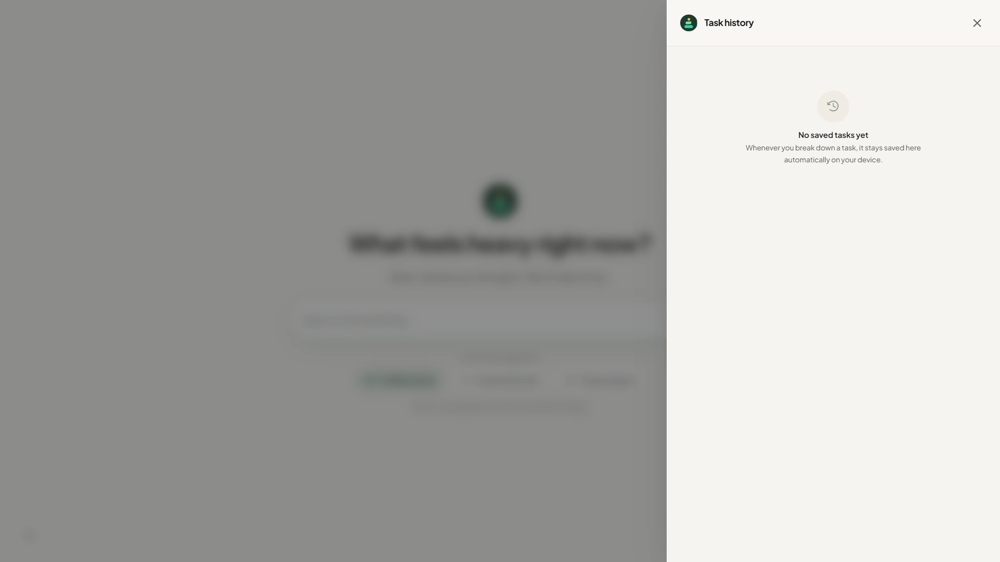
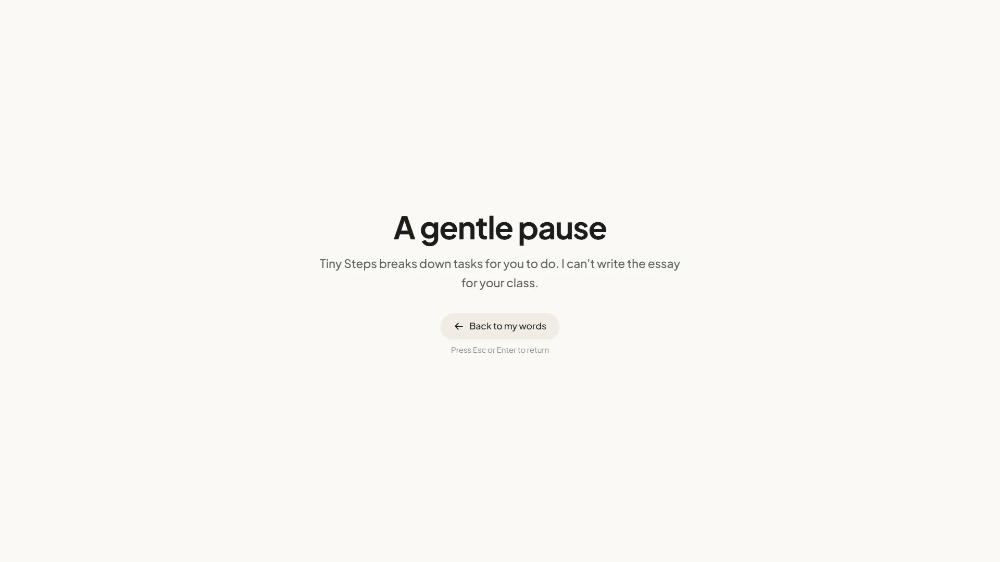

# Tiny Steps

[](https://appwrite.io/)
[](https://nextjs.org/)
[](https://react.dev/)
[](https://www.typescriptlang.org/)
[](https://tailwindcss.com/)
[](https://zustand.docs.pmnd.rs/)
[](https://bun.sh/)
[](https://opensource.org/licenses/MIT)

> 🏆 **Appwrite Databases Hackathon (October 2026)**  
> 🌐 **Live Demo:** [tiny-steps-gules.vercel.app/tasks](https://tiny-steps-gules.vercel.app/tasks) · 💻 **GitHub:** [github.com/1ewig/tiny-steps-appwrite](https://github.com/1ewig/tiny-steps-appwrite) · 📖 **Technical Architecture:** [docs/architecture.md](docs/architecture.md)

Tiny Steps turns vague or overwhelming tasks into a few concrete micro-actions you can start right away. It is built for low-energy days: one task at a time, no streaks, no guilt, and no pressure to plan everything upfront.

It is cloud-first and guest-friendly: visitors get an instant **Appwrite Anonymous Session** saving tasks directly to **Appwrite TablesDB** with zero signup friction. When you sign in with Google, your tasks seamlessly reassign to your permanent account.

## Product Demo

https://github.com/user-attachments/assets/c8b16b05-93e3-4078-abf8-a2fe9636cb72

> This video showcases the user flow of a minimalist productivity and task-management web application designed to help overwhelmed users overcome executive dysfunction by breaking down intimidating tasks into manageable micro-steps.

---

## The Flow

### 1. Set Your Energy
Describe what's on your mind and choose how much energy you have today:
- **A little stuck** (3–6 steps)
- **Overwhelmed** (3–5 gentle starter steps)
- **Full paralysis** (2–4 micro-actions, never more than 4)



### 2. Enter the Focus Tunnel
New tasks open directly into a full-screen, distraction-free tunnel isolating just one step at a time so you don't scan ahead and freeze. Advance through steps with minimal keystrokes: press `Space` or `Enter` to complete a step, `S` to break it down, or `Esc` to view the full workspace.



### 3. Spatial Workspace (Now / Next / Later)
In the full workspace, steps are organized spatially across three columns. Future steps are softly blurred by default to prevent scan panic.



### 4. Shrink Resistance On Demand
If any step feels too big or triggers hesitation, "Break it down" dynamically splits it into 2–3 bite-sized sub-steps directly within the card (strictly capped at 3 to prevent overwhelm).



### 5. Surgical In-Situ Assistant
Need to adjust reality? The unobtrusive bottom chip lets you tweak steps, reroute blockers, or add items without wiping your completed progress or dumping noisy chat transcripts. It also sets calm, zero-guilt boundaries against off-topic fluff or general trivia to keep your focus intact.



### 6. History Drawer
Review past sessions, resume incomplete tasks, or manage history with accessible confirmation dialogs.



### 7. Clear Boundaries & Gentle Pauses
Tiny Steps breaks down execution for humans—it refuses to do academic ghostwriting, solve homework, or roleplay therapy. When input falls outside its scope, a calm notice card explains the boundary with a quick way to return to your words without losing your prompt.



---

## Features at a Glance

- **Distraction-Free Focus Tunnel**: Full-screen monotasking with smooth optical morphs.
- **3-Column Workspace**: Spatial Now / Next / Later organization with anti-scan progressive disclosure.
- **On-Demand Micro-Actions**: Dynamically break intimidating steps into 2–3 smaller pieces.
- **Non-Destructive Assistant**: Surgical step surgery (modify, add, remove, reroute) preserving task immutability.
- **Clear Execution Boundaries**: Calm refusal notices that prevent machine labor substitution while safeguarding crisis inputs.
- **Sensory-Friendly Design**: Warm oatmeal canvas, calming sage accents, dim mode toggle, and reduced-motion support.
- **Guest-First Cloud Storage**: Direct Appwrite TablesDB storage for guests via Anonymous Sessions, syncing to Google OAuth upon sign-in.

---

## Architecture & Appwrite TablesDB

Tiny Steps combines instant client-side interaction with a relational Appwrite cloud backbone:

- **Direct TablesDB Writes for Guests**: Every visitor immediately gets an Appwrite Anonymous Session, saving guest tasks directly to TablesDB with native Row-Level Security (`Role.user(anonUserId)`).
- **Relational Schema**: Data is modeled as normalized `tasks` and linked `steps` with explicit order indexing on `taskId`.
- **Seamless Account Migration**: Signing in with Google OAuth reassigns existing guest tasks in TablesDB to the permanent account and cleanly merges prior cloud tasks by `updatedAt`.
- **Optimistic Zustand Core**: Mutations update the UI instantly (0ms latency) while syncing debounced changes to TablesDB in the background.
- **AI Safety & Eval Suite**: A 29-scenario automated test suite ([`scripts/eval-suite.ts`](scripts/eval-suite.ts)) benchmarks task breakdowns, crisis safeguards, and refusal boundaries against the AI Gateway.

*For complete system diagrams, data schemas, and internal mechanisms, see [docs/architecture.md](docs/architecture.md).*

---

## Stack

- **Framework**: Next.js 16 (App Router), React 19, TypeScript
- **Styling & Motion**: Tailwind CSS v4, Framer Motion, Phosphor Icons
- **State**: Zustand (with persistent localStorage middleware)
- **Database & Auth**: Appwrite TablesDB (relational with RLS) & Appwrite Google OAuth
- **AI Engine**: Vercel AI SDK and AI Gateway (`google/gemini-2.5-flash-lite`)

---

## Getting started

You need [Bun](https://bun.sh/) installed.

```bash
bun install
```

Copy `.env.example` to `.env.local` and add your AI Gateway key:

```env
AI_GATEWAY_API_KEY=your_key_here
```

Then start the app:

```bash
bun run dev
```

Open [http://localhost:3000](http://localhost:3000).

---

## Environment

| Variable | Required | Notes |
| :--- | :---: | :--- |
| `AI_GATEWAY_API_KEY` | Yes, for AI features | Without it, breakdown, shrink, and assistant calls return an error. Saved tasks still open. |
| `AI_MODEL` | No | Defaults to `google/gemini-2.5-flash-lite`. |
| `AI_REASONING_EFFORT` | No | `low` or `high`; defaults to `low`. |
| `AI_GATEWAY_BASE_URL` | No | Custom Gateway endpoint (defaults to `https://ai-gateway.vercel.sh/v4/ai`). |
| `NEXT_PUBLIC_APPWRITE_ENDPOINT` | No | Appwrite Cloud endpoint (defaults to `https://sfo.cloud.appwrite.io/v1`). |
| `NEXT_PUBLIC_APPWRITE_PROJECT_ID` | No | Appwrite project ID for TablesDB and Auth. |
| `NEXT_PUBLIC_APPWRITE_DATABASE_ID` | No | Database ID containing the `tasks` and `steps` tables. |
| `APPWRITE_API_KEY` | No | Server-side admin key for backend operations (never exposed to browser). |
| `NEXT_PUBLIC_APP_URL` | No | Public deployment URL for metadataBase and OpenGraph SEO. |

---

## Scripts

| Command | What it does |
| :--- | :--- |
| `bun run dev` | Start the development server. |
| `bun run build` | Create a production build. |
| `bun run start` | Run the production build. |
| `bun run lint` | Run Oxlint. |
| `bun run check` | Run the TypeScript checker. |
| `bun run scripts/eval-suite.ts` | Run the 29-scenario AI eval suite. |
| `bun run scripts/eval-suite.ts --relevant` | Run the real-world task scenarios only. |
| `bun run scripts/eval-suite.ts --stress` | Run the adversarial stress scenarios only. |

---

## Project layout

```text
src/
├── app/          routes and API endpoints
├── components/   UI and layout
├── hooks/        client orchestration
├── store/        Zustand state and migrations
├── lib/          AI, Appwrite, and utilities
└── types/        shared data models
```

---

## License

MIT
