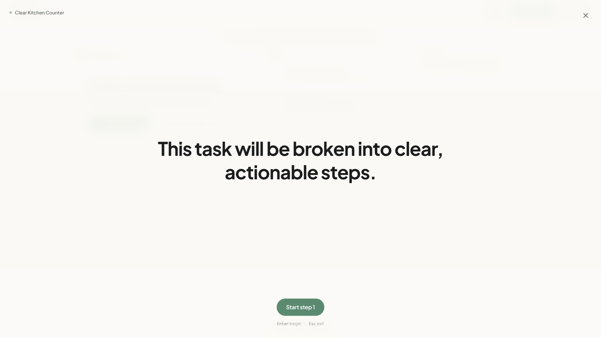

# Tiny Steps

Tiny Steps turns a vague or overwhelming task into a few concrete steps you can start right away. It is built for low-energy days: one task at a time, no streaks, no guilt, and no pressure to plan everything upfront.

See [docs/architecture.md](docs/architecture.md) for a deeper look at the internals.

You can use it as a guest. Tasks stay in your browser, and if you sign in with Google they sync to Appwrite.

## Product Demo

https://github.com/user-attachments/assets/demo (local file: `public/video/tiny-steps-demo.mp4`)

<video src="public/video/tiny-steps-demo.mp4" controls="controls" width="100%"></video>

> This video showcases the user flow of a minimalist productivity and task-management web application designed to help overwhelmed users overcome executive dysfunction by breaking down intimidating tasks into manageable micro-steps.

### Key Events & Flow

- **0:00 – 0:05 | Prompt & Input**:
  - The user is on the main screen, which asks, *"What feels heavy right now? Brain-dump your thoughts. We'll make it tiny."*
  - Below the input box, energy-level options are displayed: *A little stuck*, *Overwhelmed*, and *Full paralysis*. The user toggles through them and selects *Full paralysis*, displaying the note: *"Ultra-small initial actions to break inertia with zero pressure."*
  - The user enters their prompt: *"I've been avoiding 30 unread work emails for three days and now I have an urgent client review tomorrow morning."* and submits.

- **0:06 – 0:17 | Task Generation & Reassurance**:
  - Clean, calming loading messages appear sequentially: *"Making this smaller..."*, *"Finding your start..."*, and *"Getting things ready..."*
  - An onboarding prompt appears titled **Address Urgent Work Emails** with the compassionate validation: *"It makes complete sense that this feels heavy. We're only doing the first 60 seconds."* The user clicks **Start step 1**.

- **0:18 – 0:25 | Stepping Through Tasks**:
  - **Step 1 of 3**: *"Filter for client review emails – Type 'client review' into your email search bar."* The user marks this done.
  - **Step 2 of 3**: *"Mark one review email as read – Click the 'mark as read' button for this email."*

- **0:26 – 0:46 | Context Adjustment & Customization**:
  - The user exits the full-screen focus view to the main dashboard.
  - At the bottom, under *"Need to tweak or vent?"*, the user inputs a constraint: *"I only have my phone right now"*.
  - The system adapts dynamically, responding: *"I understand. Let's adjust for your phone,"* and revises Step 2 to: *"Swipe email to mark read onscreen."*

- **0:47 – 0:54 | Breaking Down Steps Further & Completion**:
  - When the user clicks *"Still too big? Break it down,"* the app decomposes the current step into three even smaller micro-steps:
    1. Locate the email read status symbol
    2. Position your pointer on the symbol
    3. Click the icon to mark as read
  - Checking these off completes the session, presenting a celebratory completion card: *"All steps complete. You turned initial friction into momentum."*

- **0:55 – 1:03 | Task History & Account Management**:
  - The user returns to the home screen and clicks **History** in the top-right corner to open a sidebar showing completed tasks (*Address Urgent Work Emails* and *Kitchen Help*).
  - Finally, the user opens their account menu, showing their cloud backup status and sign-out options.

---


## The Flow

### 1. Set Your Energy
Describe what's on your mind and choose how much energy you have today:
- **A little stuck** (3–6 steps)
- **Overwhelmed** (3–5 gentle starter steps)
- **Full paralysis** (2–4 micro-actions, never more than 4)

### 2. Enter the Focus Tunnel
New tasks open directly into a full-screen, distraction-free tunnel isolating just one step at a time so you don't scan ahead and freeze.



Advance through steps with minimal keystrokes. Press `Space` or `Enter` to complete a step, `S` to break it down, or `Esc` to view the full workspace.


### 3. Spatial Workspace (Now / Next / Later)
In the full workspace, steps are organized spatially across three columns. Future steps are softly blurred by default to prevent scan panic.


### 4. Shrink Resistance On Demand
If any step feels too big or triggers hesitation, "Break it down" dynamically splits it into 2–3 bite-sized sub-steps directly within the card (strictly capped at 3 to prevent overwhelm).


### 5. Surgical In-Situ Assistant
Need to adjust reality? The unobtrusive bottom chip lets you tweak steps, reroute blockers, or add items without wiping your completed progress or dumping noisy chat transcripts. It also sets calm, zero-guilt boundaries against off-topic fluff or general trivia to keep your focus intact.


### 6. History Drawer
Review past sessions, resume incomplete tasks, or manage history with accessible confirmation dialogs.


### 7. Clear Boundaries & Gentle Pauses
Tiny Steps breaks down execution for humans—it refuses to do academic ghostwriting, solve homework, or roleplay therapy. When input falls outside its scope, a calm notice card explains the boundary with a quick way to return to your words without losing your prompt.


---

## Features at a Glance

- **Distraction-Free Focus Tunnel**: Full-screen monotasking with smooth optical morphs.
- **3-Column Workspace**: Spatial Now / Next / Later organization with anti-scan progressive disclosure.
- **On-Demand Micro-Actions**: Dynamically break intimidating steps into 2–3 smaller pieces.
- **Non-Destructive Assistant**: Surgical step surgery (modify, add, remove, reroute) preserving task immutability.
- **Clear Execution Boundaries**: Calm refusal notices that prevent machine labor substitution while safeguarding crisis inputs.
- **Sensory-Friendly Design**: Warm oatmeal canvas, calming sage accents, dim mode toggle, and reduced-motion support.
- **Guest-First & Cloud-Synced**: Full offline capability via `localStorage`, with optional Appwrite TablesDB sync.

---

## Stack

- Next.js 16 (App Router), React 19, TypeScript
- Tailwind CSS v4, Zustand, Framer Motion, Phosphor Icons
- Vercel AI SDK and AI Gateway, default model `google/gemini-2.5-flash-lite`
- Appwrite TablesDB for optional cloud sync

## Database & Sync Architecture

Tiny Steps uses **Appwrite TablesDB** for relational, multi-device cloud synchronization:

- **Relational Tables**: Normalized into `tasks` and linked `steps` with explicit order indexing.
- **Row-Level Security (RLS)**: Enforces `Permission.read/update/delete(Role.user(userId))` per row on all cloud operations.
- **Local-first storage**: Tasks persist in `localStorage`. Signing in with Google OAuth migrates guest tasks into TablesDB and merges changes by `updatedAt`.

## Getting started

You need [Bun](https://bun.sh/) installed.

```bash
bun install
```

Copy `.env.example` to `.env.local` and add your AI Gateway key:

```env
AI_GATEWAY_API_KEY=your_key_here
```

Then start the app:

```bash
bun run dev
```

Open http://localhost:3000.

## Environment

| Variable | Required | Notes |
| --- | --- | --- |
| `AI_GATEWAY_API_KEY` | Yes, for AI features | Without it, breakdown, shrink, and assistant calls return an error. Saved tasks still open. |
| `AI_MODEL` | No | Defaults to `google/gemini-2.5-flash-lite`. |
| `AI_REASONING_EFFORT` | No | `low` or `high`; defaults to `low`. |
| `NEXT_PUBLIC_APPWRITE_ENDPOINT` | No | Appwrite Cloud endpoint (defaults to `https://sfo.cloud.appwrite.io/v1`). |
| `NEXT_PUBLIC_APPWRITE_PROJECT_ID` | No | Appwrite project ID for TablesDB and Auth. |
| `NEXT_PUBLIC_APPWRITE_DATABASE_ID` | No | Database ID containing the `tasks` and `steps` tables. |

## Scripts

| Command | What it does |
| --- | --- |
| `bun run dev` | Start the development server. |
| `bun run build` | Create a production build. |
| `bun run start` | Run the production build. |
| `bun run lint` | Run Oxlint. |
| `bun run check` | Run the TypeScript checker. |
| `bun run scripts/eval-suite.ts` | Run the 29-scenario AI eval suite. |
| `bun run scripts/eval-suite.ts --relevant` | Run the real-world task scenarios only. |
| `bun run scripts/eval-suite.ts --stress` | Run the adversarial stress scenarios only. |

## Project layout

```text
src/
├── app/          routes and API endpoints
├── components/   UI and layout
├── hooks/        client orchestration
├── store/        Zustand state and migrations
├── lib/          AI, Appwrite, and utilities
└── types/        shared data models
```

## License

MIT
