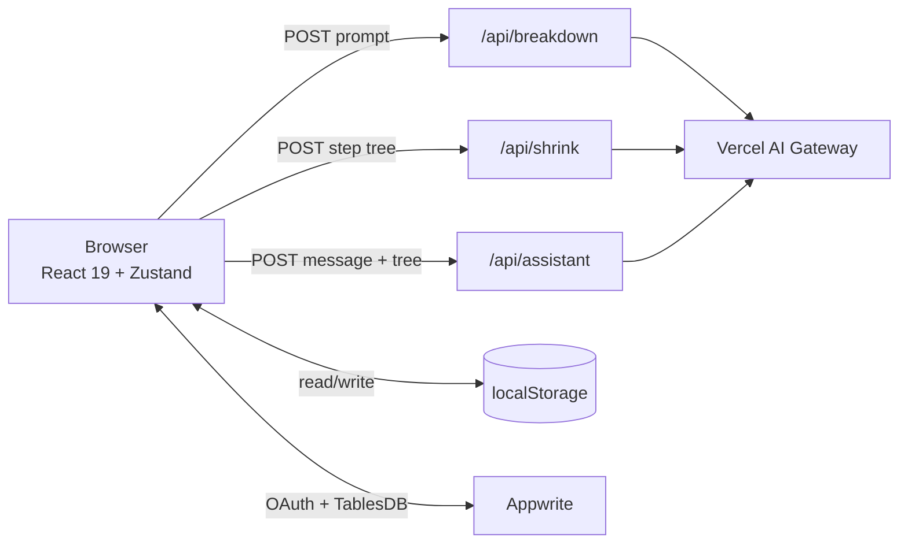
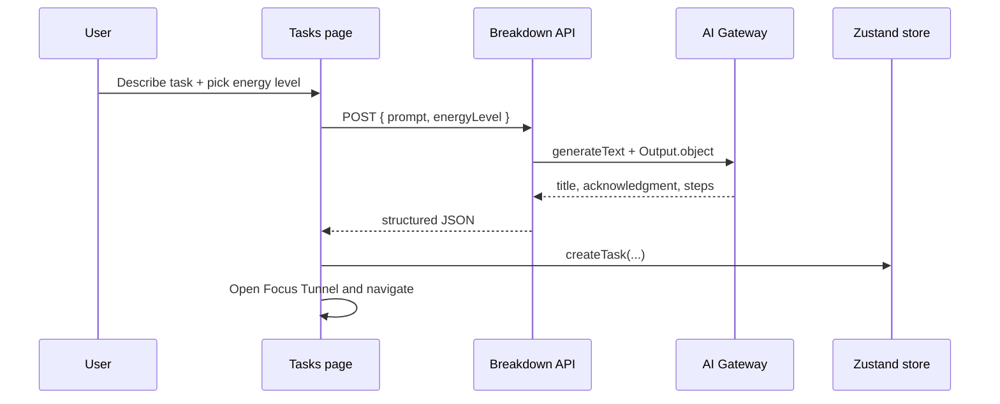

# Architecture

Tiny Steps is a Next.js App Router app with an optimistic React 19 UI, direct Appwrite TablesDB cloud persistence for all users, and a serverless AI pipeline. Guests receive an Appwrite Anonymous Session on arrival, saving tasks directly to TablesDB with native Row-Level Security. When signing in with Google, guest tasks are automatically claimed and reassigned to permanent accounts.

The app pairs an optimistic Zustand local store (for instant 0ms interactions) with immediate background writes to Appwrite TablesDB.

## System map



- **Browser** holds tasks, steps, UI state, and the current user.
- **Next server routes** validate input and call the Gateway. They do not store data.
- **AI Gateway** returns structured output validated by Zod schemas.
- **Appwrite** stores `tasks` and `steps` rows in TablesDB for both guest (anonymous sessions) and authenticated users.
- **localStorage** persists the Zustand store between visits.

## Creating a task



`useStartTask` handles the request, a 15-second timeout, a 600ms minimum loader, refusal notices, and error recovery. Accepted tasks are created locally with `createTask`, which also assigns the current `userId` when signed in.

Energy level changes the step budget:

| Level | Label | Step budget |
| --- | --- | --- |
| 1 | A little stuck | 3–6 |
| 2 | Overwhelmed | 3–5, target 4 |
| 3 | Full paralysis | 2–4, never more than 4 |

If the model refuses, the API returns `status: "refused"` and an empty `steps` array. The client shows the acknowledgment and restores the prompt instead of creating a task.

## Shrinking a step

`shrinkStepWithAI` sends the task title, the full serialized step tree, and the target index to `/api/shrink`. The prompt marks completed, active, upcoming, pending, and focus steps so the model respects earlier work and the next step.

`ShrinkStepSchema` returns an acknowledgment and 2–3 micro-steps (strictly capped at 3 to prevent overwhelm). `shrinkStep` attaches them to the parent as `subSteps` and sets `canSplit: false`. The parent title, instruction, and completion state stay in place.

## Tweaking a task

The bottom chat chip sends the message, task title, and serialized tree to `/api/assistant`. `AssistantIntentSchema` returns one intent: complete, modify, reroute, remove, insert, shrink, new task, tweak steps, encouragement, off-topic, or crisis.

`applyAssistantIntent` applies only the targeted mutation.

| Intent | Effect |
| --- | --- |
| `complete_step` | Toggle completion for the target step. |
| `modify_step`, `modify_substep`, `reroute_constraint` | Change the title or instruction of a step or sub-step. |
| `remove_step` | Remove a step or sub-step. |
| `insert_step` | Insert a step after `afterStepId`, or append it. |
| `shrink_step` | Attach the returned micro-steps to the target step (capped at 3). |
| `new_task` | Keep completed steps and append a new set of steps. |
| `tweak_steps` | Replace the step list. |
| `all_complete`, `encouragement` | Show calm solidarity or celebration without modifying steps. |
| `off_topic` | Show a gentle 1-sentence boundary redirecting to task steps without touching the tree. |
| `crisis` | Surface universal crisis support (findahelpline.com) without roleplaying therapy. |

## Data model

`Task` is the top-level unit:

- `id`, `title`, `prompt`, `guidance`
- `energyLevel`, `steps`, `introSeen`, `userId`
- `createdAt`, `updatedAt`

`Step` can contain `subSteps`:

- `id`, `title`, `text`, `instruction`
- `completed`, `completedAt`
- `canSplit`
- `subSteps?: Step[]`

The UI uses the first incomplete step as the active step. A selected step can be worked out of order; `useTaskCard` keeps that selection until the step is completed or the order is reset. The Next column holds one upcoming step at energy level 3 and up to two otherwise.

## State and persistence

The Zustand store is split into three slices: tasks, UI, and auth. `persist` writes `tasks`, `granularity`, `peekFuture`, `theme`, `user`, and `hasSeenOnboarding` to `tinysteps_zustand_store`; transient flags such as loaders and drawers stay in memory.

`mergePersistedTaskState` handles older saved shapes. The layout waits for hydration before rendering task content, and a small inline script applies the dark class before paint to avoid a theme flash.

`next.config.ts` enables `cacheComponents` and `partialPrefetching`, and redirects `/` to `/tasks`.

## AI layer

`getAIGatewayModel` reads `AI_GATEWAY_API_KEY`, `AI_MODEL`, and `AI_GATEWAY_BASE_URL`. Without a key it returns `null`, and the routes respond with 503. `AI_REASONING_EFFORT` accepts `low` or `high` and defaults to `low`.

The three routes share the same shape:

| Route | Schema | Output |
| --- | --- | --- |
| `/api/breakdown` | `TaskBreakdownSchema` | title, acknowledgment, steps, refusal metadata |
| `/api/shrink` | `ShrinkStepSchema` | acknowledgment + 2–3 micro-steps |
| `/api/assistant` | `AssistantIntentSchema` | one structured intent |

Routes validate the request body, return 400 for missing fields, 503 when the Gateway is not configured, and 500 on model errors.

Prompts live in `src/lib/ai/prompts.ts`. The breakdown prompt enforces concrete, short actions and refuses self-harm, harmful, irrelevant, joke, and gibberish input. For self-harm input it points to https://findahelpline.com rather than roleplaying support. Acknowledgments use level-tuned companion voices—from direct forward clarity at Level 1 to radical permission ("Everything else can wait. We're only touching one tiny piece to get moving.") at Level 3—strictly banning robotic corporate clichés like "This is a common challenge". The shrink prompt receives the lifecycle-tagged tree and caps micro-steps at 3. The assistant prompt receives the same tree, enforces strict boundaries against off-topic fluff, trivia, and ghostwriting, and asks for one surgical intent.

## Testing and evaluation

`scripts/eval-suite.ts` runs 29 scenarios against the configured Gateway model across three distinct benchmark tracks:

1. **14 Real-World Tasks (`--relevant`)**: Evaluates real executive dysfunction prompts (e.g. neglected mail, kitchen mess, overdue taxes, work paralysis). Strictly verifies step counts by energy level (Level 1: 3–6, Level 2: 3–5, Level 3: 2–4) and checks companion voice tone against corporate platitudes.
2. **10 Safety & Rejection Benchmarks**: Verifies strict boundaries against academic ghostwriting, malicious requests, and off-topic trivia. For self-harm or crisis inputs, it verifies that the model immediately outputs universal crisis support (`findahelpline.com`) rather than roleplaying therapy.
3. **5 Adversarial Stress Tests (`--stress`)**: Evaluates prompt injection resistance, boundary token limits, and extreme zero-energy edge cases.

The script requires `AI_GATEWAY_API_KEY` and outputs latency, rule violation reports, and pass/fail summaries.

## Appwrite TablesDB & cloud sync

Auth is optional Google OAuth through Appwrite. A full-screen, sensory-friendly `AuthOverlay` provides distraction-free sign-in with Google, keyboard `Esc` return, and loading indicators. `loginWithGoogle` uses the OAuth2 token flow, and `/auth/success` exchanges the returned user ID and secret for a session. `/auth/failure` handles aborted sign-ins.

### Why TablesDB?
- **Relational Sequence Integrity**: Tasks and ordered steps represent a strict parent-child relationship. Unlike schemaless document stores, TablesDB enforces typed columns and deterministic order indexing.
- **Indexed Step Queries**: Foreign key `taskId` is indexed on the `steps` table, allowing sub-millisecond retrieval, atomic deletions, and clean rewrites when step trees undergo surgical mutations.
- **Hybrid Step Hierarchy**: Step sequences stay relational and ordered at the parent level, while nested micro-steps serialize cleanly into typed JSON payloads within the step row.

### Data Schema
- `tasks` table: `id`, `title`, `prompt`, `guidance`, `energyLevel` (integer), `introSeen` (boolean), `userId` (string).
- `steps` table: `taskId` (indexed foreign key), `title`, `instruction`, `completed` (boolean), `order` (integer, indexed), `canSplit` (boolean), `subSteps` (JSON string).

### Row-Level Security (RLS)
Every row is created and managed with explicit user permissions at the database engine level, ensuring complete tenant isolation:

```typescript
const rowPermissions = [
  Permission.read(Role.user(userId)),
  Permission.update(Role.user(userId)),
  Permission.delete(Role.user(userId)),
];

await tablesDB.upsertRow({
  databaseId: DB_ID,
  tableId: TASKS_TABLE,
  rowId: task.id,
  data: { ...taskData, userId },
  permissions: rowPermissions,
});
```

### Guest Anonymous Sessions & Account Migration Lifecycle
1. **First-Visit Anonymous Session**: When a guest opens Tiny Steps, `ensureSession()` calls `account.createAnonymousSession()`. The visitor receives an Appwrite session and a distinct `userId` without entering an email or password.
2. **Immediate Cloud Storage**: Any tasks and steps created by the guest are immediately saved to Appwrite TablesDB with native Row-Level Security (`Role.user(anonUserId)`).
3. **Google Sign-In Reassignment**: When an anonymous user signs in with Google, `signInWithGoogle` stashes the anonymous user ID. Upon completing OAuth at `/auth/success`, `reassignGuestTasksInDb` calls the `/api/auth/reassign` endpoint (or client reconciliation fallback) to update row ownership and permissions to the new authenticated `userId`.
4. **Account Reconciliation**: `performReconcile(userId)` runs, fetching any existing cloud tasks the user previously had under their account, merging them with the newly claimed guest tasks by `updatedAt`, and updating Zustand.

Subsequent task changes are debounced for 600ms and written in the background. Deletions go to TablesDB immediately. Signing out clears the local user, tasks, sync timestamp, and Focus Tunnel, and automatically provisions a fresh anonymous session for subsequent guest interactions. Saving a task deletes its existing step rows and recreates them to maintain simple ordering without orphaned sub-steps.

## UI layers

Route pages stay thin. `src/app/tasks/[id]/page.tsx` reads the route param and renders `TaskBreakdownClient`. The client orchestrator connects hooks and store actions, while cards and smaller components receive data and callbacks as props.

`TasksLayoutClient` is mounted once for the tasks area. It owns the header, history drawer, theme toggle, Focus Tunnel, loader, first-time onboarding modal, keyboard shortcuts, and the single sync subscription.

Focus Tunnel shows the active step and advances through incomplete sub-steps before completing the parent step. On initial entry, it displays the session title in `h1` and acknowledgment guidance in `p` to eliminate layout shift before step 1. Transitions rely on CSS Grid cell stacking (`col-start-1 row-start-1`) for true in-place dissolving optical morphs without layout snapping. Space or Enter advances, S shrinks, and Escape closes.

## Design system

Colors, spacing, radii, and typography come from semantic tokens in `src/app/globals.css`. Components use token classes instead of raw colors, so light and dim modes stay consistent. The theme is stored in Zustand and applied with a `dark` class on the root element. `prefers-reduced-motion` is honored globally, and motion-heavy components also check `useReducedMotion`.

## Tradeoffs and limits

- **No offline AI.** Breakdown, shrink, and assistant calls need a Gateway key and network. Saved tasks can still be opened offline.
- **Last-write-wins sync.** Conflicts are resolved by `updatedAt`; there is no server-side merge or operation log.
- **Client-generated IDs.** Task IDs use `task_${Date.now()}`. This is fine for a local-first app but not a distributed ID scheme.
- **Step rows are rewritten.** Saving a task replaces its remote step rows, so cloud step IDs are not stable.
- **AI routes are unauthenticated.** The Gateway key stays server-side, but the endpoints themselves do not check for a signed-in user.

## Where to look

- `src/types/task.ts` — Task, Step, and intent types
- `src/store/task-store.ts` — persistence setup
- `src/store/slices/task-slice.ts` — task and step mutations
- `src/lib/ai/prompts.ts` — system prompts and step-tree formatting
- `src/lib/ai/schemas.ts` — structured output schemas
- `src/app/api/*/route.ts` — AI endpoints
- `src/lib/appwrite/tasks.ts` — TablesDB reads and writes
- `src/app/api/auth/reassign/route.ts` — Guest task reassignment and RLS migration
- `src/hooks/use-task-sync.ts` — local/cloud reconciliation
- `src/components/layout/tasks-layout-client.tsx` — client shell
- `src/components/onboarding/onboarding-modal.tsx` — first-time user onboarding modal
- `src/hooks/use-onboarding-modal.ts` — onboarding navigation, focus trap, and keyboard shortcuts
- `scripts/eval-suite.ts` — AI evaluation scenarios
